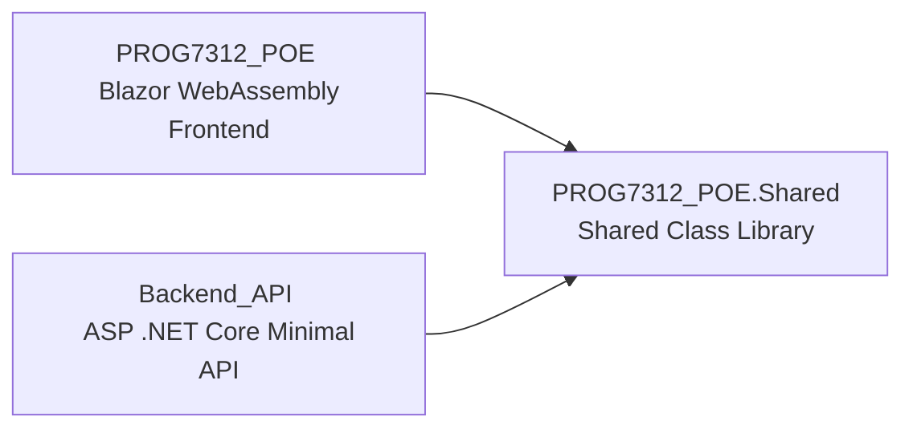

# PROG7312 POE Part 1 - Smart X System

**About this Smart X Project:**
This system is built using a .NET 10 solution with a Blazor WebAssembly project for frontend, an ASP .NET Core Minimal API project for the backend API and a Shared Class Library to allow frontend and backend to talk to each other.
Currently the project satisfies Part 1 of the PoE and Parts 2 and 3 will be implemented at a later stage.
Part 1 includes a dashboard which simulates IoT sensors in Smart Buildings as well as the data they send as we do not have access to actual ESP32s to use actual hardware devices.

**Project Architecture Structure:**


As you can see the architecture structure above, both the frontend and backend projects reference the Shared Class Library instead of referencing each other.

**Features implemented in Part 1:**
- Sensor Registration (Device Mac Address, Main Zone, Sub-Zone, Floor, Room or Area, Sensor Category and Sensor Type) with optional Media file attachment upload
- Simulated live telemetry which is generated server-side and ingested through the Backend API
- Live Dashboard (KPIs, sensor status by zone, sensor readings by category, temperature and energy chart, main zone filtering, alert detection and other telemetry)

**PART 1 DATA STRUCTURES and where they are used:**
| Structure | What it does | File |
|---|---|---|
| Generics | To handle disparate incoming data structures uniformly without resorting to expensive boxing/unboxing operations | (TelemetryPacket<T>) in PROG7312_POE.Shared Models Folder |
| Operator Overloading | To allow direct aggregation or delta comparisons of sensor values in code | PowerReading class in PROG7312_POE.Shared Models Folder |
| Advanced Arrays/jagged arrays and Lists | These put raw readings into batches before transferring them into a List<T> for storage. | RawTelemetryBatchBuffer.cs and RawTelemetryBatchService.cs in Backend_API project under Services folder |
| Recursion | This validates a Sensors Main Zone -> Sub-Zone path against the BuildingConfigurationService.cs classes deployment tree in the Backend_API project Services folder | TreeValidatorForDeployment.cs file in PROG7312_POE.Shared Validation folder |

**Dashboard Engagement Feature:**
As per my Task 1 Research of Part 1 in which i chose the real-time visual telemetry feedback strategy, i have implemented this strategy in my frontend. I made use of a bar chart for energy readings and a line chart for temperature readings, coloured dots representing Sensor status and category grouped readings. The sensor readings also update every 5-10 seconds as real-time simulated data is being sent through.

**Known Limitations of the application:**
- Application makes use of in-memory storage which does not allow data to persist everytime the API is restarted
- No Authentication/Authorization
- Simulated telemetry, not real telemetry from actual hardware devices

**Technologies Used:**
- .NET 10
- ASP .NET Core Minimal API
- Blazor WebAssembly
- Github
- Github Desktop
- Docker Desktop
- Chart.js library for Bar and Line charts

**Improvement of Design:**
In my application, i have designed it that currently, the system could be used for 1 specific building and add all sensors in that particular building. I could improve this design if necessary to allow buildings to be the first entry rather than the current Main Zone entry. This improvement would then allow an organization or a group of investors who manage or own more than 1 building and want to use 1 application for their sensor monitoring across all their buildings. Having said this, they could still use the application as it is designed currently but would have several different instances of the application running to see each individual building. The improvement would allow 1 instance of the application for them to see all their buildings and the sensors for each building. This is just a more efficient improvement that could be made to the application.

**YouTube Video Presentation Link PART 1:**
https://youtu.be/zTut_YZjuDE

# PROG7312 POE Part 2 - Smart X System

**Navigation:**
The navigation menu has IoT Sensor Telemetry (Part 1), Sensor Registration (Part 1), Command Stream and History (Part 2) and Network Map (Final Part of PoE/Part 3), which currently holds placeholder text until implemented. Dashboard filters, stream page filters and dashboard alerts are kept in a client-side state service (AppStateService), so they are still there when you switch to a different page and come back.

**Features implemented in Part 2:**
- Command Stream and History Page
  - Contains queue statistics, live device table, search by text, search by category, search by alertState, search by mainZone and a processing order view
  - Manual override commands for actuators (smart relays, water pumps, valves and ventilation fans), which also includes a bulk command (e.g: turn all water pumps off), and Undo command button
  - Active alerts and an alert event log
  - Predictions: for every numeric sensor, the system learns its pattern and forecasts its next high and low
  - Suggested Actions and Automated Insights based on the users searches and commands history
 
**PART 2 DATA STRUCTURES and where they are used:**
| Structure | What it does | File |
|---|---|---|
| Queue<T> | Standard FIFO processing of incoming telemetry packets | Backend_API/Services/TelemetryIngestionQueueService.cs |
| PriorityQueue | Critical packets are processed before the standard queue | Backend_API/Services/TelemetryIngestionQueueService.cs, Backend_API/Services/TelemetryPriorityClassifier.cs |
| Stack<T> | History of manual commands and used for Undo | Backend_API/Services/CommandService.cs
| Dictionary | Live devices keyed by deviceMacAddress for 0(1) lookups | Backend_API/Services/DeviceStateService.cs |
| SortedDictionary | Per-device history sorted by TimeStamp | Backend_API/Services/TelemetryHistoryService.cs |
| HashSet | Unique active alerts and disconnected nodes which stops duplicate alerts | Backend_API/Services/AlertStateService.cs |

The critical queue is always checked first. The processing loop that drains the queues is in TelemetryProcessorService.cs

**How to test the queue and dictionary implementations:**
Open the API's Swagger page (http://localhost:8081/swagger in Docker). First register a few sensors on the Sensor Registration page, for example a Temperature sensor and a CO2 sensor in Occupied Spaces, a Pipe Pressure sensor in Technical and Utility, and two Water Pumps and two Valves under Actuators and Controls. Then:

- Priority queue (simulating a high-priority alert): call POST /api/stream/test/flood?count=30. This puts 30 normal packets in the standard queue and then one critical smoke and fire packet last. Straight afterwards, call GET /api/stream/queue-stats. In recentlyProcessed the critical packet is processed before the standard ones even though it was added last. The same thing is visible on the Stream and History page under Processing Order.
- FIFO queue: in the same recentlyProcessed list the standard packets keep their original order (the sequence numbers go up one by one)
- Dictionary: call GET /api/stream/devices to list the live devices and GET /api/stream/devices/{mac} to fetch one by its MAC address. The lookup is a dictionary key lookup.
- SortedDictionary: call GET /api/stream/history/{mac}?count=20. The readings come back in timestamp order.
- HashSet: call POST /api/stream/test/disconnect/{mac} for a sensor and wait about 40 seconds. Then call GET /api/stream/alerts. The sensor appears once in activeAlertKeys as mac|OFFLINE, and duplicatesSuppressed goes up each time the system tries to raise the same alert again. Call POST /api/stream/test/reconnect/{mac} and the alert is resolved.
- Stack and Undo: on the Stream and History page, turn a pump on, then run a bulk command (for example, all Valve devices on). Press Undo once and the whole bulk command is reverted, then press it again and the pump command is reverted. The undo stack list shows the stack from top to bottom.
- Search and filter: on the Stream and History page type part of a MAC address or sensor type, pick a category or zone, and click the alert state buttons (Critical, Offline, Warning, Normal). The table updates and the buttons show counts.

**Prediction engine ("AI"):**
Each numeric sensor is analysed from its own history. The simulator gives sensors a repeating daily cycle (one simulated day takes 15 minutes), and the engine finds every episode where a sensor went above its high limit or below its low limit. For every episode, it records when it started, how long it took to get there from its normal level, how long it lasted and how high or low it peaked. From the last few episodes it works out the average gap between them, the typical duration and the typical peak, and forecasts the next high and the next low. The confidence score is based on how regular the gaps are and how many episodes there are. It also fits a straight line through the last few readings, which gives a warning such as "at this trend it crosses the limit in 40 seconds".

To test it without waiting: call POST /api/analytics/test/backfill?minutes=60 (this creates an hour of past history using the same daily cycle), then call GET /api/analytics/episodes/{mac} to see the detected episodes and call GET /api/analytics/forecast/{mac} for the prediction. The predictions also show on the Stream and History page. To check accuracy, note the predictedStart of the next high, wait for that time and check the episodes list again.

**Suggestion engine:**
Searches that the user makes themselves and every manual command are recorded, together with which sensor types were alerting when a command was sent. The engine then offers: your usual searches as one click views, commands that you repeat, and learnt responses, for example "when Temperature was alerting, you turned the ventilation fans on", which is suggested again when Temperature is alerting now or is predicted to alert within two minutes. These appear as Suggested Actions, next to Automated Insights such as the number of devices needing attention, the sensor type raising the most alerts and the next predicted events.

To test it: choose a category in the device search, clear it and choose it again (do this at least 3 times), and an "Open your usual view" suggestion appears. For a learnt response call POST /api/suggestions/test/seed?trigger=Temperature&actuator=Ventilation Fan&turnOn=true, which records three past commands. Within a few minutes, when Temperature alerts or is predicted to alert, the suggestion "Turn all Ventilation Fan devices ON" appears and can be run with one click.

**YouTube Video Presentation Link PART 2:**
https://youtu.be/_0Pzg88R6Lk

# PROG7312 Final POE Part 3 - Smart X System

**Setup Instructions:**
- Run Project locally:
  - Open terminal in the project solution root and run dotnet restore
  - Then run dotnet build
  - change directory to Backend_API project and run dotnet run
  - change directory to PROG7312_POE frontend project and run dotnet run
  - These need to both run simultaneously in 2 different terminals and take note of the 2 ports

- Run with Docker:
  - Open and have Docker Desktop running
  - Navigate to the project solution path and double click the docker-setup.bat file
  - That builds the containers, waits for the client/frontend container to respond and automatically opens http://localhost:8080
  - The Backend API is also reachable at http://localhost:8081/swagger for testing separately

**PART 3 DATA STRUCTURES and where they are used:**
| Structure | What it does | File |
|---|---|---|
| AVL Tree | Stores every timestamped reading per device in a self-balancing tree so a time range is found in O(log n + k) without scanning the full history | Backend_API/Data_Structures/AvlTree.cs, Backend_API/Services/TelemetryHistoryService.cs |
| Graph | Models the mesh network: vertices are the sensors and the gateway, and edges are weighted wireless links | Backend_API/Data_Structures/Graph.cs, Backend_API/Services/MeshTopologyService.cs |
| Breadth-First Search (BFS) | Finds every device reachable from the gateway, identifies the ones that are down, and finds an alternative route (self-healing) by skipping offline nodes | Backend_API/Data_Structures/GraphTraversal.cs, Backend_API/Services/MeshRoutingService.cs |
| Prim's Minimum Spanning Tree | Calculates the most power-efficient set of links that connects every node to the gateway | Backend_API/Data_Structures/MinimumSpanningTree.cs, Backend_API/Services/MeshMstService.cs |
| PriorityQueue | Used by Prim’s algorithm to always pick the cheapest available edge next, with a (cost, order) tie-break so the result is deterministic | Backend_API/Data_Structures/MinimumSpanningTree.cs |
| Queue<T> | The BFS, which visits nodes in order of hop count | Backend_API/Data_Structures/GraphTraversal.cs |
| Dictionary | Maps each device’s MAC address to its AVL tree (archive) and to its mesh node, and holds the BFS parent and hop-count maps so routes can be rebuilt | Backend_API/Services/TelemetryHistoryService.cs, Backend_API/Services/MeshTopologyService.cs, Backend_API/Data_Structures/GraphTraversal.cs |
| HashSet | Tracks visited vertices and the vertices already in the MST, so nothing is processed twice | Backend_API/Data_Structures/GraphTraversal.cs, Backend_API/Data_Structures/MinimumSpanningTree.cs |
| Stack<T> | Iterative depth-first walk that finds connected components, so separate clusters can be bridged into one network | Backend_API/Services/MeshTopologyService.cs |

**Code Examples from the Network Topology and Mesh Routing Feature:**

AVL Tree:
```csharp
private static void Collect(Node? node, TKey from, TKey to, List<TValue> results, ref int visited)
{
    if (node is null)
    {
        return;
    }

    visited++;

    var againstLow = from.CompareTo(node.Key);
    var againstHigh = to.CompareTo(node.Key);

    if (againstLow < 0)
    {
        Collect(node.Left, from, to, results, ref visited);
    }

    if (againstLow <= 0 && againstHigh >= 0)
    {
        results.Add(node.Value);
    }

    if (againstHigh > 0)
    {
        Collect(node.Right, from, to, results, ref visited);
    }
}
```
Pulls all readings between a time-range and skips whole subtrees that cannot hold matches

Graph:
```csharp
public bool AddEdge(string a, string b, double weight)
{
    AddVertex(a);
    AddVertex(b);

    if (a == b || HasEdge(a, b))
    {
        return false;
    }

    _adjacency[a].Add(new EdgeOfGraph(a, b, weight));
    _adjacency[b].Add(new EdgeOfGraph(b, a, weight));
    EdgeCount++;
    return true;
}
```
Each link is stored in both directions, so the mesh is undirected

Breadth-First Search (BFS):
```csharp
var queue = new Queue<string>();
queue.Enqueue(start);
result.Hops[start] = 0;

while (queue.Count > 0)
{
    var current = queue.Dequeue();
    result.Order.Add(current);

    // Cheapest link first, so ties between equal-hop routes always resolve the same way
    var neighbours = graph.NeighboursOf(current)
        .OrderBy(edge => edge.Weight)
        .ThenBy(edge => edge.To, StringComparer.Ordinal);

    foreach (var edge in neighbours)
    {
        if (result.Hops.ContainsKey(edge.To) || !isAllowed(edge.To))
        {
            continue;
        }

        result.Hops[edge.To] = result.Hops[current] + 1;
        result.Parent[edge.To] = current;
        queue.Enqueue(edge.To);
    }
}
```
isAllowed treats offline nodes as if they do not exist, which is how the route is re-calculated around a failed sensor

Prim's MST and the PriorityQueue:
```csharp
var inTree = new HashSet<string> { root };

// The priority is cost and arrival number, so equal cost links come out in the order they were found
var heap = new PriorityQueue<EdgeOfGraph, (double Cost, long Order)>();
long order = 0;

void PushLinksFrom(string vertex)
{
    foreach (var edge in graph.NeighboursOf(vertex))
    {
        if (!inTree.Contains(edge.To) && isAllowed(edge.To))
        {
            heap.Enqueue(edge, (edge.Weight, order++));
            result.HeapPushes++;
        }
    }
}

PushLinksFrom(root);

while (heap.Count > 0)
{
    var cheapest = heap.Dequeue();

    // Another link already brought this node into the tree so this one would make a loop
    if (!inTree.Add(cheapest.To))
    {
        continue;
    }

    result.Edges.Add(cheapest);
    result.TotalWeight += cheapest.Weight;
    result.Parent[cheapest.To] = cheapest.From;

    PushLinksFrom(cheapest.To);
}
```
The priority queue always returns the cheapest link leaving the tree, with the arrival order as a tie-break so results are deterministic

**Role of each structure in the efficiency of the Network Topology and Mesh Routing feature:**
**AVL Tree (Historical Telemetry Log)**: Every device keeps its readings in an AVL tree keyed by timestamp. Because the tree rebalances itself with rotations, its height stays at roughly log n, so a query such as "all readings between 14:00 and 16:00 for this node" skips every subtree outside the range and costs O(log n + k), where k is the number of readings returned. A plain list would have to be scanned from start to finish, which is O(n) and keeps getting slower as the archive grows. The query also reports how many nodes it visited, which is how the benchmark endpoint proves the difference.

**Graph (Live mesh map)**: The mesh is stored as a dictionary of edge lists, so memory is O(Vertices + Edges) and finding a sensor's neighbours is O(degree). Each sensor only links to a few nearby sensors. This is far smaller than an adjacency matrix which would need Verice × Vertice cells even though most pairs of sensors are not connected.

**BFS and Queue<T> (Route tracker and devices connected to the gateway)**: BFS visits every vertex and link at most once, so a full reachability check from the gateway is O(Vertice + Edge). Because the queue spreads outwards one hop at a time, the first time a sensor is reached is always by the route with the fewest hops, so no route needs to be compared or sorted afterwards. The isAllowed predicate removes offline sensors from the search, so the same code finds a new route around a failure and identifies which sensors are down or cut off, without a separate algorithm for self-healing.

**Prim's MST and PriorityQueue (Power-efficient routing)**: The priority queue returns the cheapest link leaving the tree in O(log Edge), so the whole algorithm runs in O(Edge log Vertice) instead of re-scanning every link each time a node is added. The result connects every sensor to the gateway for the lowest total link cost which is the power saving shown on the page. The (cost, order) priority means that links with the same cost are always chosen in the same order, so the tree does not change between refreshes.

**Dictionary and HashSet (supporting structures)**: Dictionaries give O(1) lookups of a device by MAC address and hold the BFS hop counts and parents, from which a route is rebuilt without searching. The HashSet makes the "is this sensor already in the tree?" check O(1), which is what stops Prim's algorithm from adding a link that would form a loop.

**Stack<T> (building the topology)**: An iterative depth-first walk with a stack finds the connected components of the generated mesh in O(Vertice + Edge), so separate clusters can be joined and every sensor can reach the gateway. Using a stack instead of recursion avoids deep call chains on a large network.

**Navigation:**
The navigation menu has IoT Sensor Telemetry (Part 1), Sensor Registration (Part 1), Command Stream and History (Part 2) and Network Map (Final Part of PoE/Part 3), the application is now fully active.

**Features implemented in Part 3:**
- Network Topology and Mesh Routing Page
  - Summary cards showing sensors online, wireless links, devices reaching the gateway, devices down or cut off, and the power saved by the minimum spanning tree
  - Live mesh map: every sensor is a node and every wireless link is an edge, drawn around the central gateway. Nodes are coloured by status (online, warning, critical, offline) and can be clicked to select them. A toggle overlays the minimum spanning tree on the map
  - Route tracker: type or pick a sensor's MAC address and see the hop-by-hop route its data takes to the gateway, with the hop count and cost. Simulate failures and Restore buttons take the sensors on the route offline and bring them back, so the self-healing re-route can be seen
  - Power-efficient routing (MST): a table comparing each sensor's cost along the minimum spanning tree against its cost along the fewest-hop route, with the overall power saving
  - Devices connected to the gateway: a zone (subnet) filter and three lists: reachable devices (with their hops and a Track button), devices that are down, and devices that are cut off because every path to them goes through a failed node
  - Historical telemetry log: for the selected sensor, a time-stamped table of readings between a From and To date, with quick ranges (last 10 minutes, last hour, last 24 hours), retrieved from the AVL tree archive

**YouTube Video Presentation Link PART 3:**
https://youtu.be/QQCMFc4x5ak
