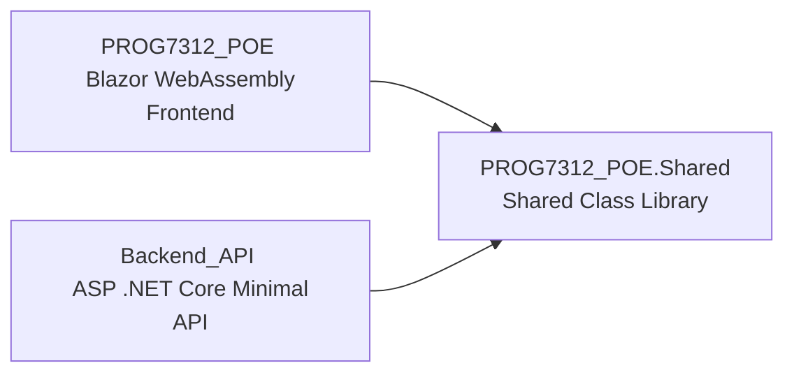

# PROG7312 POE Part 1 - Smart X System

**About this Smart X Project:**
This system is built using a .NET 10 solution with a Blazor WebAssembly project for frontend, an ASP .NET Core Minimal API project for the backend API and a Shared Class Library to allow frontend and backend to talk to each other.
Currently the project satisfies Part 1 of the PoE and Parts 2 and 3 will be implemented at a later stage.
Part 1 includes a dashboard which simulates IoT sensors in Smart Buildings as well as the data they send as we do not have access to actual ESP32s to use actual hardware devices.

**Project Architecture Structure:**

As you can see the architecture structure above, both the frontend and backend projects reference the Shared Class Library instead of reference each other.

**Setup Instructions:**
- Run Project locally:
  - Open terminal in the project solution root and run dotnet restore
  - Then run dotnet build
  - change directory to Backend_API project and run dotnet run
  - change directory to PROG7312_POE frontend project and run dotnet run
  - These need to both run simultaneously in 2 different terminals and take note of the 2 ports

- Run with Docker:
  - Open and have Docker Desktop running
  - Navigate to the project solution path and double click the docker-setup.bat file
  - That builds the containers, waits for the client/frontend container to respond and automatically opens http://localhost:8080
  - The Backend API is also reachable at http://localhost:8081/swagger for testing separately

**Features implemented in Part 1:**
- Sensor Registration (Device Mac Address, Main Zone, Sub-Zone, Floor, Room or Area, Sensor Category and Sensor Type) with optional Media file attachment upload
- Simulated live telemetry which is generated server-side and ingested through the Backend API
- Live Dashboard (KPIs, sensor status by zone, sensor readings by category, temperature and energy chart, main zone filtering, alert detection and other telemetry)

**Technical and Language Requirements:**
- Generics -> I have used a Generic wrapper class (TelemetryPacket<T>) in the PROG7312_POE.Shared Models Folder
- Operator Overloading -> I have used Operator Overloading in the PowerReading class in the PROG7312_POE.Shared Models Folder
- Advanced Arrays/jagged arrays and Lists -> I have used Advanced Arrays/jagged arrays and Lists in RawTelemetryBatchBuffer.cs and RawTelemetryBatchService.cs in the Backend_API project under Services folder. These put raw readings into batches before transferring them into a List<T> for storage.
- Recursion -> I have used recursion in the TreeValidatorForDeployment.cs file in the PROG7312_POE.Shared Validation folder. This validates a Sensors Main Zone -> Sub-Zone path against the BuildingConfigurationService.cs classes deployment tree in the Backend_API project Services folder

**Dashboard Engagement Feature:**
As per my Task 1 Research of Part 1 in which i chose the real-time visual telemetry feedback strategy, i have implemented this strategy in my frontend. I made use of a bar chart for energy readings and a line chart for temperature readings, coloured dots representing Sensor status and category grouped readings. The sensor readings also update every 5-10 seconds as real-time simulated data is being sent through.

**Known Limitations of the application:**
- Application makes use of in-memory storage which does not allow data to persist everytime the API is restarted
- No Authentication/Authorization
- Simulated telemetry, not real telemetry from actual hardware devices

**Technologies Used:**
- .NET 10
- ASP .NET Core Minimal API
- Blazor WebAssembly
- Github
- Github Desktop
- Docker Desktop
- Chart.js library for Bar and Line charts

**Improvement of Design:**
In my application, i have designed it that currently, the system could be used for 1 specific building and add all sensors in that particular building. I could improve this design if necessary to allow buildings to be the first entry rather than the current Main Zone entry. This improvement would then allow an organization or a group of investors who manage or own more than 1 building and want to use 1 application for their sensor monitoring across all their buildings. Having said this, they could still use the application as it is designed currently but would have several different instances of the application running to see each individual building. The improvement would allow 1 instance of the application for them to see all their buildings and the sensors for each building. This is just a more efficient improvement that could be made to the application.

**Youtube Video Presentation Link:**
https://youtu.be/zTut_YZjuDE
